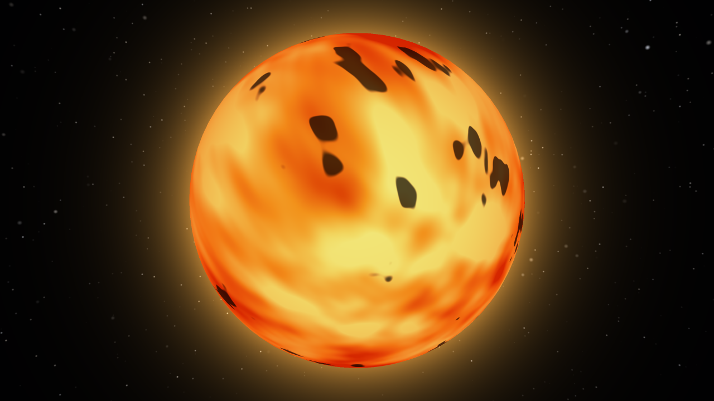
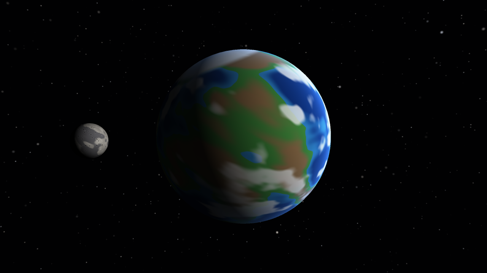
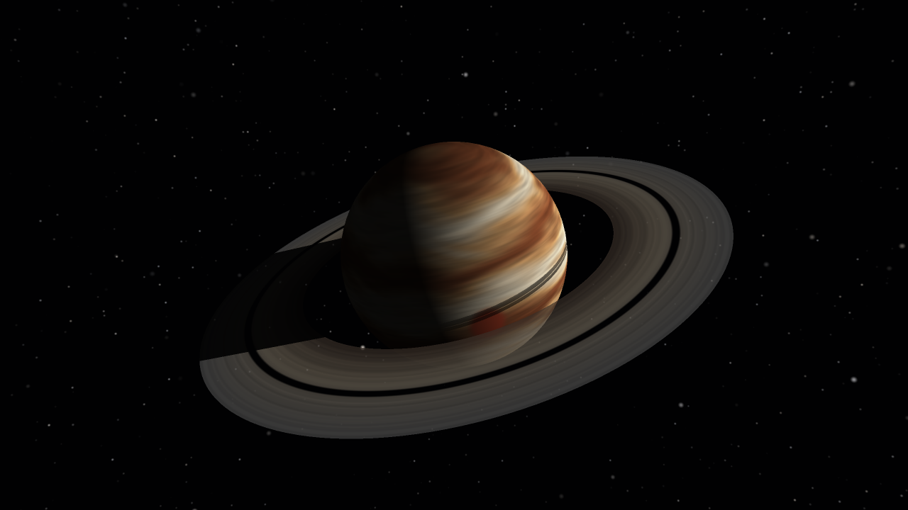
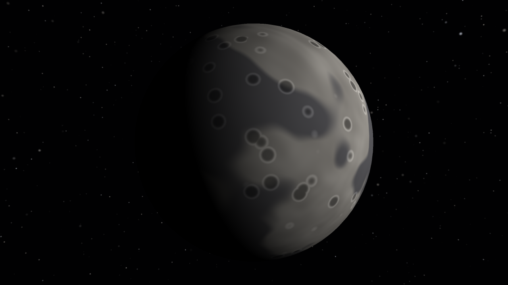
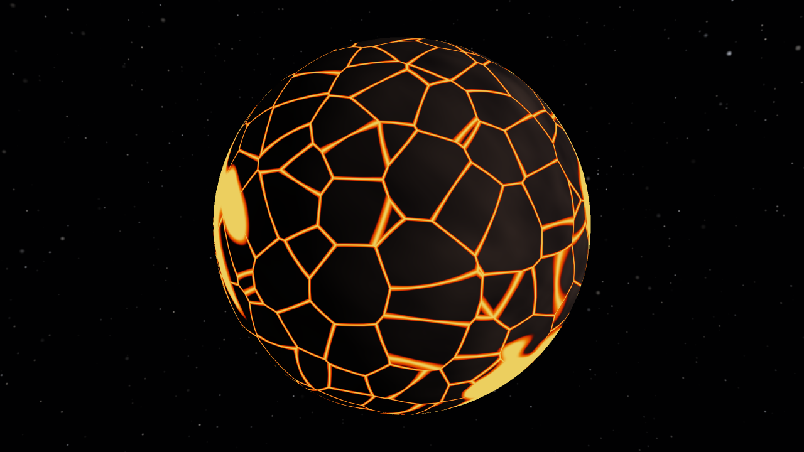
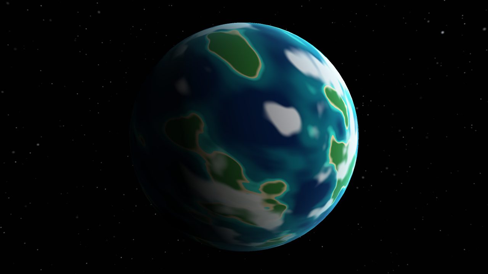
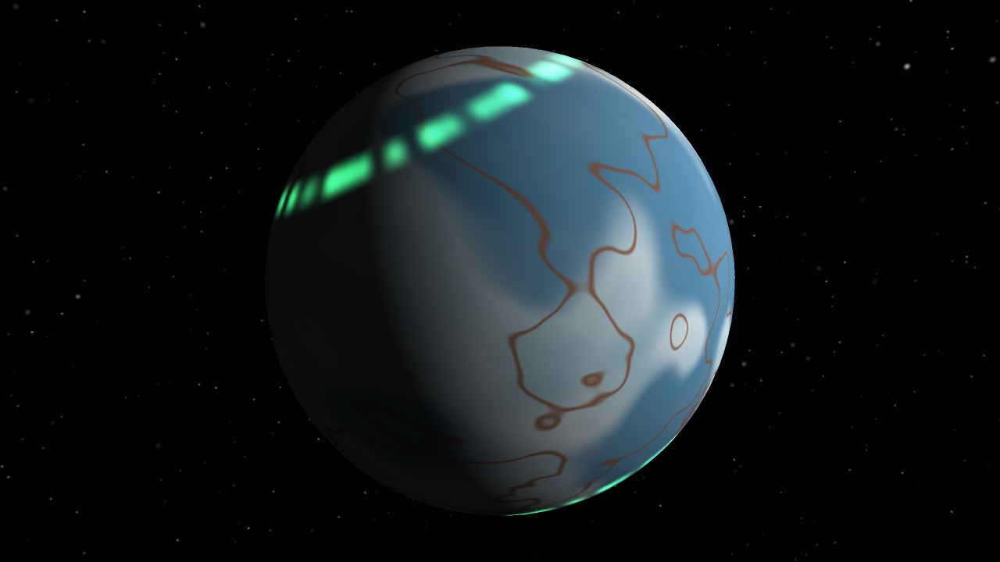

# graficas-shaders

Lab de shaders: un sistema solar hecho **solo con shaders** en un renderer de software en Rust (sin texturas ni materiales). Los colores salen de ruido, la posición del píxel, la luz y el tiempo.


## Ejecutar

```bash
cargo run                                   # ventana interactiva (ya va optimizado)
cargo run -- --capturas                     # regenera las imágenes de screenshots/
cargo run -- --bench                        # tiempo por cuadro de cada vista
cargo test
```

## Controles

| Tecla | Acción |
|---|---|
| `0` | Sistema solar completo (rotación y traslación) |
| `1` – `7` | Ignis, Terranova, Ámbar, Nácar, Magma, Coral, Glaciar |
| `Tab` | Siguiente cuerpo |
| `←` `→` `↑` `↓` | Girar la cámara alrededor del cuerpo |
| `W` / `S` | Acercar / alejar |
| `Espacio` | Pausa |
| `+` / `-` | Más rápido / más lento |
| `Q` | Calidad completa / rápida |
| `R` | Reiniciar la cámara |
| `Esc` | Salir |

## Cuerpos celestes

Cada shader está escrito por **capas** que modifican el color; en el código están marcadas como `// Capa N`.

### 1. Ignis — la estrella (`src/shaders/ignis.rs`)



1. **Plasma**: ruido que se mueve con el tiempo, con colores de rojo a amarillo.
2. **Manchas solares** oscuras.
3. **Borde** más oscuro y rojizo.
4. **Pulso** de brillo.

Alrededor tiene un brillo naranja (la corona).

### 2. Terranova — planeta rocoso (`src/shaders/terranova.rs`)



1. **Océano**: más claro cerca de la costa.
2. **Tierra**: verde en lo bajo y café en lo alto.
3. **Polos** de hielo.
4. **Nubes** que giran.
5. **Atmósfera** azul en el borde.

### 3. Ámbar — gigante gaseoso con anillos (`src/shaders/ambar.rs`, `src/shaders/anillos.rs`)



1. **Bandas** horizontales deformadas con ruido.
2. **Vetas** finas a lo largo de las bandas.
3. **Tormenta** rojiza.
4. **Sombra de los anillos** sobre el planeta.

**Anillos** — modelo aparte (un disco con agujero, en `Mesh::ring`) con transparencia:

1. **Densidad** con líneas finas y un hueco grande.
2. **Color** según la distancia al planeta.
3. **Sombra del planeta** sobre los anillos.

### 4. Nácar — luna de Terranova (`src/shaders/nacar.rs`)

Modelo aparte que orbita alrededor de Terranova (se ve en la vista `2` y en el sistema).



1. **Polvo** gris.
2. **Mares** oscuros.
3. **Cráteres**: centro oscuro y borde claro.
4. **Luz** dura, sin atmósfera.

### Planetas extra

#### Magma — planeta volcánico (`src/shaders/magma.rs`)



1. **Roca** oscura.
2. **Grietas de lava** (bordes de celdas de Voronoi).
3. **Lagos de lava**.
4. **Brillo** de la lava, que late con el tiempo.

#### Coral — mundo océano (`src/shaders/coral.rs`)



1. **Océano** profundo.
2. **Arrecifes** turquesa.
3. **Islas** de arena y selva.
4. **Nubes** que giran.
5. **Atmósfera** cian.

#### Glaciar — planeta de hielo (`src/shaders/glaciar.rs`)



1. **Hielo** blanco y celeste.
2. **Agua** azul bajo el hielo.
3. **Grietas** color óxido.
4. **Auroras** verdes en los polos.

## Rúbrica

| Criterio | Cómo se cumple |
|---|---|
| Complejidad (4+ capas) | Todos los planetas tienen 4 o 5 capas de color. |
| Planetas extra (3) | Magma, Coral y Glaciar. |
| Anillos en el gaseoso | Ámbar: modelo aparte, transparente, con un hueco, y sombras en ambos sentidos. |
| Luna | Nácar orbita alrededor de Terranova (modelo aparte). |
| Opcional: rotación y traslación | Vista `0`: cada planeta gira sobre su eje inclinado y orbita al sol; la luna orbita a Terranova. |

## Cómo funciona

| Archivo | Qué hace |
|---|---|
| `assets/sphere.obj` | La esfera que usan todos los cuerpos (se carga con el lector OBJ propio). |
| `src/obj.rs` | Lector OBJ y el modelo de los anillos. |
| `src/raster.rs` | Rasterizador con z-buffer. Guarda los datos de cada píxel y después se les calcula el color; los anillos van en una capa transparente aparte. |
| `src/scene.rs` | Cuerpos, órbitas, cámara, estrellas de fondo y el brillo del sol. Los colores se calculan en varios hilos para que vaya más rápido. |
| `src/noise.rs` | Ruido 3D, fBm y Voronoi. |
| `src/shaders/` | Un archivo por cuerpo celeste. |

Las estrellas del fondo también se generan con código.
