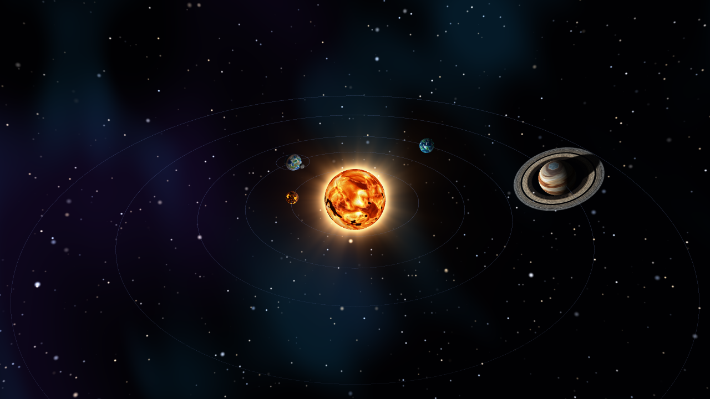
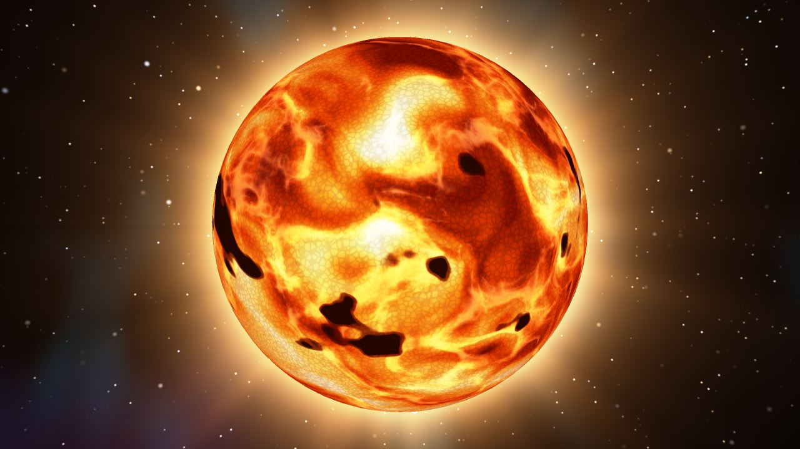
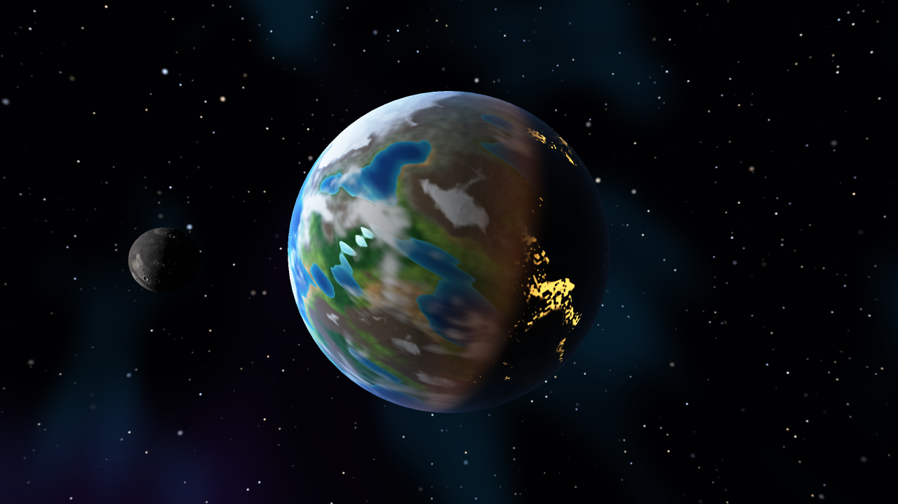
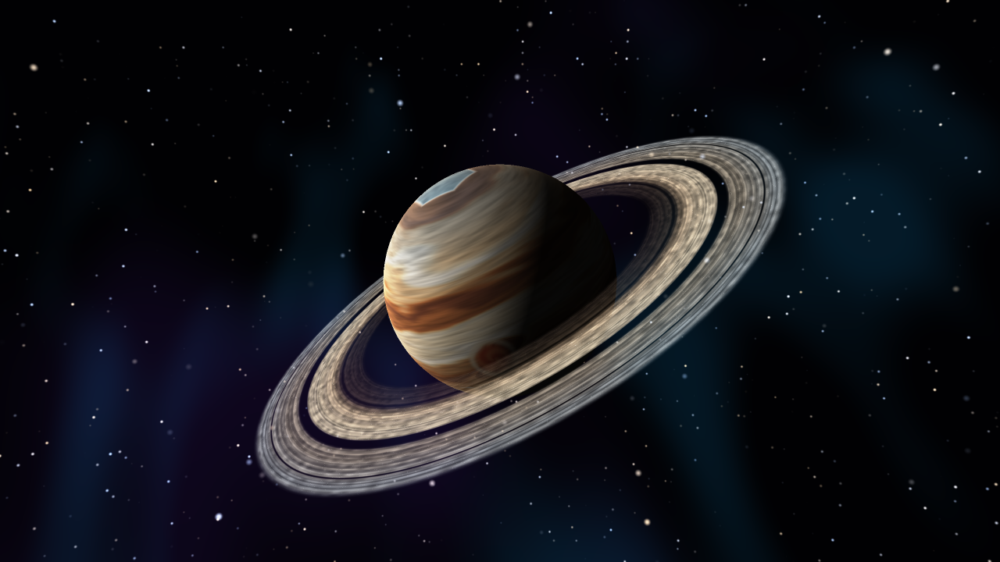
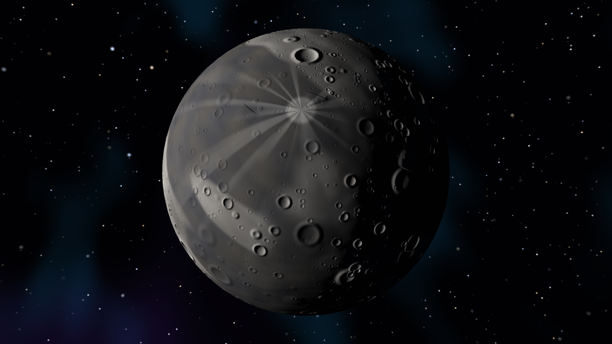
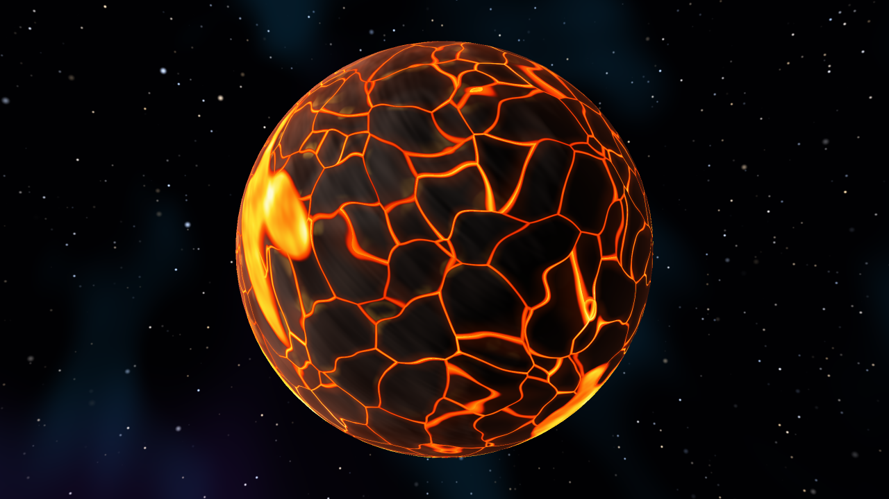
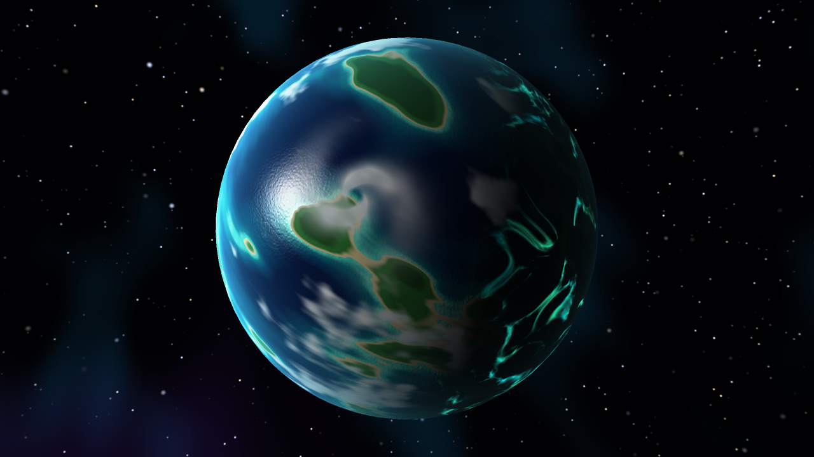
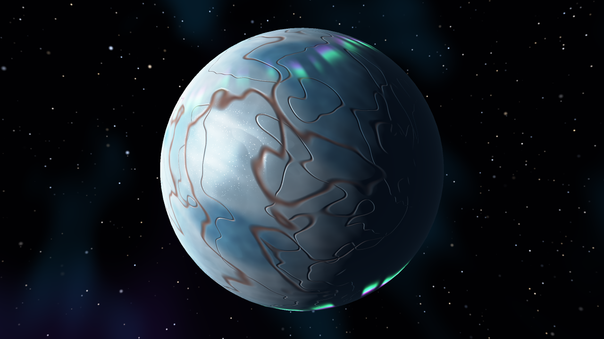

# graficas-shaders

Lab de shaders: un sistema solar hecho **solo con fragment shaders** sobre un renderer de software propio en Rust (sin GPU, sin librerías 3D, sin texturas ni materiales). Todos los colores salen de ruido procedural, la posición del píxel, su normal, la luz y el tiempo.



## Ejecutar

```bash
cargo run                                   # ventana interactiva (ya va optimizado)
cargo run -- --capturas                     # regenera las imágenes de screenshots/
cargo run -- --bench                        # tiempo por cuadro de cada vista
cargo test
```

## Controles

| Tecla | Acción |
|---|---|
| `0` | Sistema solar completo (rotación y traslación) |
| `1` – `7` | Helios, Gaia, Cronos, Selene, Vulcano, Thalassa, Boreas |
| `Tab` | Siguiente cuerpo |
| `←` `→` `↑` `↓` | Girar la cámara alrededor del cuerpo |
| `W` / `S` | Acercar / alejar |
| `Espacio` | Pausa |
| `+` / `-` | Más rápido / más lento |
| `Q` | Calidad completa / rápida |
| `R` | Reiniciar la cámara |
| `Esc` | Salir |

## Cuerpos celestes

Cada shader está escrito por **capas** que modifican el color; en el código están marcadas como `// Capa N`.

### 1. Helios — la estrella (`src/shaders/helios.rs`)



1. **Plasma**: ruido fBm con *domain warping* (un ruido deforma las coordenadas de otro) que se mueve con el tiempo, pasado por una rampa de rojo oscuro → naranja → amarillo → blanco.
2. **Granulación**: celdas de Voronoi; los bordes entre celdas son el gas más frío que baja.
3. **Manchas solares** con umbra y penumbra, solo en latitudes medias.
4. **Fáculas y filamentos**: crestas brillantes (ruido *ridged*) que fluyen.
5. **Oscurecimiento de borde** (*limb darkening*): el borde es más rojo y tenue.
6. **Pulso** de brillo de toda la estrella.
7. **Corona** (post-proceso): halo con serpentinas animadas alrededor del disco.

### 2. Gaia — planeta rocoso (`src/shaders/gaia.rs`)



1. **Océano**: color según la profundidad, con aguas turquesa en la costa y reflejo especular del sol.
2. **Biomas**: desierto, pradera, selva y tundra según temperatura (latitud y altura) y humedad (otro ruido).
3. **Montañas**: roca y nieve en las cumbres, con relieve (*bump mapping*).
4. **Casquetes polares** que también congelan el mar.
5. **Nubes** que giran más rápido que el planeta y proyectan sombra sobre el suelo.
6. **Luces de ciudades** en el lado de noche (solo en tierra templada y tapadas por las nubes).
7. **Atmósfera**: halo azul en el borde y tono anaranjado en el atardecer.

### 3. Cronos — gigante gaseoso con anillos (`src/shaders/cronos.rs`, `src/shaders/anillos.rs`)



1. **Bandas** de zonas y cinturones distorsionadas por ruido, con rotación diferencial (cada latitud gira a otra velocidad).
2. **Turbulencia**: vetas finas estiradas por el viento, tonos azulados hacia los polos y pequeños óvalos blancos.
3. **Gran tormenta**: las bandas se enroscan alrededor del ojo, que tiene una espiral animada.
4. **Hexágono polar** (como el de Saturno).
5. **Sombra de los anillos** sobre el planeta (rayo hacia la luz contra el plano de los anillos).
6. **Atmósfera** cálida en el borde.

**Anillos** — modelo aparte (un disco con agujero generado en `Mesh::ring`) con su propio shader y transparencia:

1. **Densidad radial** con anillos C, B y A, la división de Cassini y la de Encke (define la transparencia).
2. **Color** según la distancia: polvo rojizo adentro, hielo claro afuera.
3. **Grumos y destellos** de partículas de hielo.
4. **Sombra del planeta** sobre los anillos y **retroiluminación** al mirar hacia el sol.

### 4. Selene — luna de Gaia (`src/shaders/selene.rs`)

Modelo aparte que orbita alrededor de Gaia (se ve en la vista `2` y en el sistema).



1. **Regolito**: polvo gris con variaciones.
2. **Mares** de basalto oscuro (con menos cráteres).
3. **Cráteres** a tres escalas: cuenco oscuro y borde claro, con relieve.
4. **Rayos de eyección** de un cráter joven.
5. **Luz dura** sin atmósfera, con relieve y un poco de "luz de tierra" azulada.

### Planetas extra

#### Vulcano — planeta volcánico (`src/shaders/vulcano.rs`)



1. **Corteza de basalto** negra con relieve.
2. **Grietas**: bordes de celdas de Voronoi deformadas; placas de roca flotando sobre lava.
3. **Lagos de lava** que fluyen.
4. **Azufre y ceniza** junto a las zonas calientes.
5. **Emisión**: la lava brilla sola (también de noche) y late con el tiempo.
6. **Atmósfera de humo** rojiza.

#### Thalassa — mundo océano (`src/shaders/thalassa.rs`)



1. **Océano profundo** de índigo a verde azulado.
2. **Arrecifes** turquesa alrededor de las islas.
3. **Islas**: playa y selva.
4. **Huracanes** en espiral y nubes dispersas.
5. **Bioluminiscencia**: de noche el mar brilla con corrientes de plancton animadas.
6. **Atmósfera** húmeda color cian.

#### Boreas — planeta de hielo (`src/shaders/boreas.rs`)



1. **Hielo** blanco y celeste.
2. **Océano bajo el hielo** que se ve en zonas azul profundo.
3. **Grietas** largas teñidas de sales rojizas (como Europa).
4. **Escarcha**: brillo especular con destellos de cristales.
5. **Auroras** verdes y magenta en ambos polos que ondulan con el tiempo (más intensas de noche).
6. **Atmósfera** tenue.

## Rúbrica

| Criterio | Cómo se cumple |
|---|---|
| Complejidad (4+ capas) | Todos los shaders tienen entre 5 y 7 capas de color. |
| Planetas extra (3) | Vulcano, Thalassa y Boreas. |
| Anillos en el gaseoso | Cronos: modelo aparte, transparente, con huecos, y sombras en ambos sentidos. |
| Luna | Selene orbita alrededor de Gaia (modelo aparte). |
| Opcional: rotación y traslación | Vista `0`: cada planeta gira sobre su eje inclinado y orbita al sol; la luna orbita a Gaia. |

## Cómo funciona

| Archivo | Qué hace |
|---|---|
| `assets/sphere.obj` | La esfera que usan todos los cuerpos (se carga con el lector OBJ propio). |
| `src/obj.rs` | Lector OBJ y el modelo de los anillos. |
| `src/raster.rs` | Rasterizador con recorte, z-buffer y corrección de perspectiva. Escribe un **G-buffer** (sombreado diferido): una capa opaca y una transparente para los anillos. |
| `src/scene.rs` | Cuerpos, órbitas, cámara y el pipeline: rasterizar → sombrear cada píxel **en paralelo** (un hilo por bloque de filas) → corona, estrellas y órbitas. |
| `src/noise.rs` | Ruido de valor 3D, fBm, ruido *ridged* y Voronoi. |
| `src/shaders/` | Un archivo por cuerpo celeste. |

El fondo (nebulosa y estrellas) también es procedural. Las capturas se generan con supermuestreo 2×2 para suavizar los bordes.
